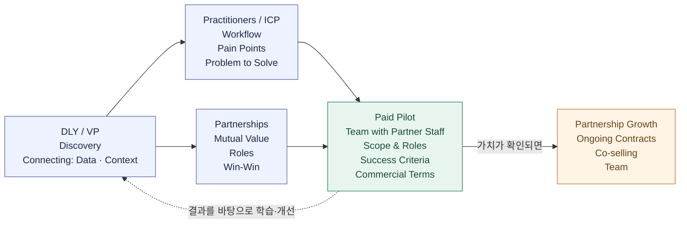

# 왜 연결하는 방식으로 사업을 만드는가

> 2026-10-26 · 업데이트 2026-10-28

## 내 생각

기술과 기능이 빠르게 대체되는 시대에, 현장과 고객을 이해하는 데서 사업의 가치를 만들어가려 합니다.

내 사업의 지분과 주도권을 지키면서, 파트너와 함께 가치를 만들고 성장해가려 합니다.

현장에 들어가 고객의 이야기를 듣고 신뢰를 쌓는 일을 계속해가려 합니다. 그 위에서 사례를 모으며 다음 세 방향을 구체화해가려 합니다.

1. **파트너십**: 고객이 이미 사용하는 툴을 제공하는 기업과 협력 관계를 만들고, 기존 생태계 안에서 고객 도입과 영어권 시장 확장을 함께 추진하기.
2. **제품 방향**: 기존 툴에서 쓰이는 데이터와 맥락을 연결해 고객의 더 나은 의사결정을 돕기.
3. **팀**: 나와 에이전트, 파트너사 내부 인원이 소규모 프로젝트 팀으로 함께 일하기. 파일럿부터 각자의 역할을 정하고, 함께 일하며 필요한 역량을 갖춰가기.

### 파트너와 어떻게 사업을 만들어갈 것인가

나와 에이전트가 실무자와 소통하며 문제와 사용 중인 도구를 알아갑니다. 그 문제를 함께 해결할 파트너를 찾고, 파트너사 내부 인원과 소규모 팀으로 유료 파일럿을 진행하려 합니다. 결과를 바탕으로 데이터와 맥락을 연결하는 역량을 키우고, 다음 계약과 협력으로 이어가려 합니다.

**DLY / VP — Discovery · Connecting**

사람들을 만나 이야기를 듣고, 실무자의 문제와 파트너와 함께할 가능성을 알아갑니다. 필요한 데이터와 맥락을 연결해 실무자가 활용할 수 있게 돕고 싶습니다.

**Practitioners / ICP — 실무자와 해결할 문제 찾기**

실무자와 이야기하며 어떻게 일하고, 무엇이 어려운지 알아갑니다. 그중 내가 함께 해결할 문제를 찾습니다.

**Partnerships — 함께할 이유와 역할 찾기**

파트너와 서로 무엇을 보태고 얻을 수 있는지 알아갑니다. 각자의 강점을 바탕으로 함께 일할 수 있는 구조를 그립니다. 혼자 현장에서 계약까지 이어가기 쉽지 않다고 느끼기에, 파트너와 함께 들어갈 수 있는 환경을 만드는 것이 중요하다고 생각합니다.

**Paid Pilot — 파트너사 내부 인원과 유료로 문제 해결하기**

나와 에이전트, 파트너사 내부 인원이 소규모 팀으로 현장에 들어가 해결할 문제와 각자의 역할을 정하고, 유료로 진행합니다. 기간·비용·비용을 부담할 주체와 수익 배분을 합의하고, 실제 업무에서 도움이 되는지 확인합니다. 비용을 부담하는 쪽은 현장 조직과 파트너 기업 모두 열어두고 있습니다.

**Partnership Growth — 성과를 다음 계약과 협력으로 이어가기**

함께 만든 성과를 바탕으로 지속 계약과 공동판매를 넓혀갑니다. 필요한 역량과 팀을 갖추고, 성과와 상호 의사·조건이 맞으면 투자 유치나 엑싯도 검토합니다.

현재 지향하는 사업 흐름입니다. 이 그림을 두고 내가 보태려는 가치를 하나씩 실제로 확인해가려 합니다. 결과를 바탕으로 방향을 고치고, 도움이 된 경험을 역량과 사업의 강점으로 쌓아가려 합니다.

### 생각하는 수익모델

파트너 생태계에 연결해 도입할 수 있는 수익모델을 만들어가려 합니다. 초기에는 파트너와 수행할 유료 파일럿이나 서비스의 범위를 합의하고, 지속적인 사용에 맞는 요금 구조를 구체화하려 합니다.

- **초기 셋업**: 초기 도입 부담을 낮춘 비용.
- **구독**: 지속적인 서비스 이용에 대한 요금.
- **추가 사용료**: API 호출 등 사용량에 따른 요금.

## 참고한 것들

### 제품 방향에서 참고하는 것

- **Glean**: 흩어진 정보와 맥락을 연결해 필요한 내용을 이해하고 활용하도록 돕는 방식.
- **Wiz**: 서로 다른 전문가들이 같은 상황을 한눈에 이해할 수 있도록 정보를 연결하고 시각화하는 방식.

### 파트너십과 팀에서 참고하는 플레이와 사례

**내가 지향하는 플레이**: [지노빌리](manu-ginobili-role-reference-ko.md) 같은 플레이를 선호하고, 내 현장 이해와 제품을 더해 파트너 기업이 더 잘하도록 돕고 함께 성장해가려 합니다.

- **[AWS Global Startup Program](https://aws.amazon.com/partners/programs/global-startup/)**: AWS 기술 전문가·Partner Solutions Architect의 제품 설계와 고객 적용 지원, Account Manager와의 공동판매를 제공하는 프로그램. 초청·참여 요건이 있습니다.
- **[Pixellot–Prozone (2015)](https://www.pixellot.tv/press-releases/prozone-invests-1m-in-israeli-technology-company-pixellot/)**: Prozone이 Pixellot에 미화 100만 달러를 투자하고, 양사의 기술과 Prozone의 기존 프로스포츠 고객 기반을 연결하는 협력을 발표한 사례.

### 현장에서 검토 중인 사례 — 검사 데이터와 현장 맥락 연결

> 2026-10-28 · 현장 대화를 출발점으로 정리한 협업 가설. 개인과 기관을 식별할 수 있는 내용은 생략했습니다.

검사 도구를 사용하는 현장 실무자와 이야기하며, 검사 결과와 같은 선수·날짜의 상태 및 현장 기록을 함께 살펴보는 일을 출발점으로 잡았습니다. 기존 방식에서 해결되는 부분과 여전히 남는 일을 확인하고, 도구 제공사와 우리가 각각 무엇을 보탤 수 있는지 검토하려 합니다.

**먼저 살펴볼 도구 제공사: Hawkin Dynamics**

Hawkin은 [Hawkin Connect](https://connect.hawkindynamics.com/)를 통해 API와 스프레드시트 연동 도구를 안내하고 있습니다. Google Sheets 도구는 확인 당시 Marketplace 심사 대기로 표시되어 있었습니다. 실제 현장 계정의 이용 조건과 필요한 데이터의 연동 범위는 별도 확인이 필요합니다.

이미 제공되는 연결 기능을 활용하면서, 연결된 정보를 실제 업무에서 검토하고 다음 판단에 활용하는 과정을 어디까지 도울 수 있는지 알아보려 합니다. 단순히 데이터를 가져오는 기능만으로 우리 역할이 충분하다고 보지는 않습니다.

**각자가 얻을 가치와 맡을 역할**

아래는 상대와 합의한 조건이 아니라, 협의하며 검증할 초안입니다.

| 주체 | 얻을 수 있는 가치 | 제공하거나 맡을 역할 |
| --- | --- | --- |
| 현장 실무자·팀 | 필요한 정보를 찾아 맞추는 부담을 줄이고, 검사 결과를 현장 맥락과 함께 검토하기 | 실제 업무와 필요한 결과 설명, 작은 사례 검토, 기존 방식 대비 효용 피드백 |
| Hawkin | 고객이 검사 데이터를 업무에 활용하는 사례와 제품·연동 피드백, 향후 공동 고객 기회 | 기존 기능과 연동 조건 안내, 필요한 기술 담당자 참여, 지표·데이터 해석 지원 |
| DLY·나와 에이전트 | 실제 사용 기준과 구현 역량 축적, 검증된 사례를 다음 계약으로 연결할 기회 | 현장 문제 정리, 데이터·맥락 연결 설계, 작은 시제품 제작과 비교 검증 |

**작게 시작할 방법과 다음 조건**

1. 현장 관찰과 대화로 실제 검토 장면 하나를 고르고, 기존 도구와 자체 작업으로 해결되는 범위를 확인합니다.
2. 가상 예시 또는 기관이 허용한 자료로 작은 결과물을 만들어, 실무자가 기존 방식보다 도움이 되는지 판단할 수 있게 합니다.
3. 추가 가치와 참여 의사가 확인되면 현장팀·Hawkin·DLY의 담당자, 작업 범위, 성공 기준을 정합니다. 유료 파일럿의 비용 부담 주체·기간·지원 범위·수익 배분도 이때 협의합니다.

우리에게는 검증된 현장 사례, 실무자에게는 업무상 개선, 제공사에는 고객의 활용 가치가 남는 구조를 만들고 싶습니다. 공동판매와 고객 소개는 그 결과와 상호 동의를 바탕으로 넓혀갈 다음 단계입니다.

**아직 확인할 것:** 기존 기능 대비 추가 가치, 현장팀의 참여·도입 권한과 예산, 데이터 사용 범위, Hawkin의 협업 의사와 상업 조건. 현재는 협업 가능성을 검토하는 단계이며, 파트너십·유료 파일럿·효과가 확인된 성공 사례는 아닙니다.

[중심에서 삶과 실행으로](center-life-means-experiments-ko.md)

## 참고 문헌

조여준(Ethan Cho)의 [「공룡의 멸종 사이클이 빨라지고 있다」](https://lnkd.in/p/gHwyqDvq)는 AI 시장에서 모델 성능과 UX의 차별화가 빠르게 따라잡힐 수 있으며, 고객에게 도달하는 경로와 고객 맥락을 이해하는 기반이 중요하다고 이야기합니다.
