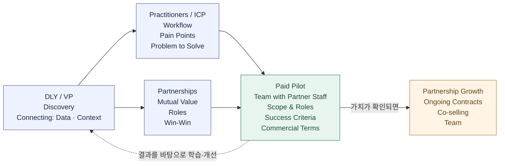

# 왜 연결하는 방식으로 사업을 만드는가

> 2026-10-26 · 업데이트 2026-10-28

## 내 생각

기술과 기능이 빠르게 대체되는 시대에, 현장과 고객을 이해하는 데서 사업의 가치를 만들어가려 합니다.

내 사업의 지분과 주도권을 지키면서, 파트너와 함께 가치를 만들고 성장해가려 합니다.

현장에 들어가 고객의 이야기를 듣고 신뢰를 쌓는 일을 계속해가려 합니다. 그 위에서 사례를 모으며 다음 세 방향을 구체화해가려 합니다.

1. **파트너십**: 고객이 이미 사용하는 툴을 제공하는 기업과 협력 관계를 만들고, 기존 생태계 안에서 고객 도입과 영어권 시장 확장을 함께 추진하기.
2. **제품 방향**: 기존 툴에서 쓰이는 데이터와 맥락을 연결해 고객의 더 나은 의사결정을 돕기.
3. **팀**: 나와 에이전트, 파트너사 내부 인원이 소규모 프로젝트 팀으로 함께 일하기. 파일럿부터 각자의 역할을 정하고, 함께 일하며 필요한 역량을 갖춰가기.

### 파트너와 어떻게 사업을 만들어갈 것인가

나와 에이전트가 실무자와 소통하며 문제와 사용 중인 도구를 알아갑니다. 그 문제를 함께 해결할 파트너를 찾고, 파트너사 내부 인원과 소규모 팀으로 유료 파일럿을 진행하려 합니다. 결과를 바탕으로 데이터와 맥락을 연결하는 역량을 키우고, 다음 계약과 협력으로 이어가려 합니다.

**DLY / VP — Discovery · Connecting**

사람들을 만나 이야기를 듣고, 실무자의 문제와 파트너와 함께할 가능성을 알아갑니다. 필요한 데이터와 맥락을 연결해 실무자가 활용할 수 있게 돕고 싶습니다.

**Practitioners / ICP — 실무자와 해결할 문제 찾기**

실무자와 이야기하며 어떻게 일하고, 무엇이 어려운지 알아갑니다. 그중 내가 함께 해결할 문제를 찾습니다.

**Partnerships — 함께할 이유와 역할 찾기**

파트너와 서로 무엇을 보태고 얻을 수 있는지 알아갑니다. 각자의 강점을 바탕으로 함께 일할 수 있는 구조를 그립니다. 혼자 현장에서 계약까지 이어가기 쉽지 않다고 느끼기에, 파트너와 함께 들어갈 수 있는 환경을 만드는 것이 중요하다고 생각합니다.

**Paid Pilot — 파트너사 내부 인원과 유료로 문제 해결하기**

나와 에이전트, 파트너사 내부 인원이 소규모 팀으로 현장에 들어가 해결할 문제와 각자의 역할을 정하고, 유료로 진행합니다. 기간·비용·비용을 부담할 주체와 수익 배분을 합의하고, 실제 업무에서 도움이 되는지 확인합니다. 비용을 부담하는 쪽은 현장 조직과 파트너 기업 모두 열어두고 있습니다.

**Partnership Growth — 성과를 다음 계약과 협력으로 이어가기**

함께 만든 성과를 바탕으로 지속 계약과 공동판매를 넓혀갑니다. 필요한 역량과 팀을 갖추고, 성과와 상호 의사·조건이 맞으면 투자 유치나 엑싯도 검토합니다.

현재 지향하는 사업 흐름입니다. 이 그림을 두고 내가 보태려는 가치를 하나씩 실제로 확인해가려 합니다. 결과를 바탕으로 방향을 고치고, 도움이 된 경험을 역량과 사업의 강점으로 쌓아가려 합니다.

### 생각하는 수익모델

파트너 생태계에 연결해 도입할 수 있는 수익모델을 만들어가려 합니다. 초기에는 파트너와 수행할 유료 파일럿이나 서비스의 범위를 합의하고, 지속적인 사용에 맞는 요금 구조를 구체화하려 합니다.

- **초기 셋업**: 초기 도입 부담을 낮춘 비용.
- **구독**: 지속적인 서비스 이용에 대한 요금.
- **추가 사용료**: API 호출 등 사용량에 따른 요금.

## 참고한 것들

### 제품 방향에서 참고하는 것

- **Glean**: 흩어진 정보와 맥락을 연결해 필요한 내용을 이해하고 활용하도록 돕는 방식.
- **Wiz**: 서로 다른 전문가들이 같은 상황을 한눈에 이해할 수 있도록 정보를 연결하고 시각화하는 방식.

### 파트너십과 팀에서 참고하는 플레이와 사례

**내가 지향하는 플레이**: [지노빌리](manu-ginobili-role-reference-ko.md) 같은 플레이를 선호하고, 내 현장 이해와 제품을 더해 파트너 기업이 더 잘하도록 돕고 함께 성장해가려 합니다.

- **[AWS Global Startup Program](https://aws.amazon.com/partners/programs/global-startup/)**: AWS 기술 전문가·Partner Solutions Architect의 제품 설계와 고객 적용 지원, Account Manager와의 공동판매를 제공하는 프로그램. 초청·참여 요건이 있습니다.
- **[Pixellot–Prozone (2015)](https://www.pixellot.tv/press-releases/prozone-invests-1m-in-israeli-technology-company-pixellot/)**: Prozone이 Pixellot에 미화 100만 달러를 투자하고, 양사의 기술과 Prozone의 기존 프로스포츠 고객 기반을 연결하는 협력을 발표한 사례.

### 참고 사례 — Sevensense × ABB: 공동개발·고객 파일럿에서 파트너의 투자·인수까지

> 2026-10-28 · 공개 자료로 확인한 사례. 내가 지향하는 협업 구조와 비교하며 계속 살펴볼 기록입니다.

내가 찾아보려는 경로는 **나와 에이전트가 파트너사 내부 인원과 소규모 팀으로 ICP의 문제를 해결하고, 파일럿에서 가치를 확인한 파트너가 투자하거나 인수까지 검토하는 것**입니다. 함께 일하면서 고객에게 주는 가치와 서로의 역량을 확인해가는 방식입니다.

Sevensense–ABB는 같은 파트너와의 협력이 고객 현장 적용과 인수까지 이어진 사례입니다. 다만 협력 당시 Sevensense는 25명이었고, 양사의 공동 프로젝트 인원은 공개되지 않았습니다. 나처럼 작은 팀이 같은 방식으로 시작했다는 근거로 보기는 어렵습니다.

**각자가 보탠 것과 함께 해결한 문제**

- **Sevensense:** 로봇이 주변을 보고 위치와 이동 경로를 판단하는 Visual SLAM 기술.
- **ABB:** 기존 이동 로봇 제품과 고객 적용 기반. Sevensense의 기술을 자사 제품에 결합.
- **현장 고객:** 사람과 물건이 계속 움직이는 공장·물류 환경에서 로봇을 더 유연하게 운용할 필요.

ABB는 2021년 Innovation Challenge에서 여러 회사의 기술을 평가한 뒤 Sevensense를 파트너로 선정했습니다. 기존 제품에 보탤 기능과 고객에게 제공할 가치가 구체적인 협력이었습니다. [ABB의 파트너십 발표](https://new.abb.com/news/detail/84645/abb-partners-with-start-up-sevensense-to-drive-next-generation-autonomous-mobile-robots)

**확인된 순서**

| 시점 | 확인된 내용 |
| --- | --- |
| 2018년 | Sevensense가 ETH Zurich에서 분사해 창업 |
| 2021년 | ABB의 기술 평가를 거쳐 파트너로 선정. ABB Technology Ventures가 770만 달러 Series A를 주도하고 사업 협력을 시작 |
| 2022년 계획 → 이후 실행 확인 | ABB 로봇에 기술을 통합하는 고객 파일럿을 계획. 2024년 인수 발표에서 자동차·물류 업계 고객 파일럿 수행을 확인 |
| 2023년 4월 | ABB가 공동개발 기술을 적용할 구체적인 로봇 모델과 출시 일정을 발표. 자동차·유통 고객 현장 적용도 명시 |
| 2024년 1월 | 협력·투자 파트너였던 ABB가 Sevensense를 인수. 당시 Sevensense 인원은 약 35명 |

이 사례는 **기술 평가 → 파트너십·투자 → 공동개발·고객 파일럿 → 제품 적용 → 같은 파트너의 인수** 순서입니다. 파일럿 이후 첫 투자를 받은 사례는 아닙니다. 770만 달러는 전체 라운드 금액이며 ABB 단독 투자액은 아닙니다. [투자 거래 자문사의 발표](https://www.walderwyss.com/en/news/2021-12-08_sevensense-raises-usd-7-7m-series-a) · [공동개발 제품 발표](https://new.abb.com/news/detail/102327/prsrl-abb-transforms-amr-performance-with-launch-of-visual-slam-technology) · [인수 발표](https://new.abb.com/news/detail/111398/abb-acquires-sevensense-expanding-leadership-in-next-generation-ai-enabled-mobile-robotics)

**함께 만든 결과가 파트너의 제품에 남았다는 점**

공동개발 결과는 ABB의 실제 로봇 모델과 출시 일정에 포함됐습니다. ABB는 이 기술이 기존 2D SLAM 방식 대비 설치·가동 준비 시간을 최대 20% 줄일 수 있다고 발표했습니다. 이는 회사가 발표한 제품 성능 수치이며, 개별 파일럿의 평가 결과나 매출이 공개된 것은 아닙니다. [2023년 제품 발표](https://new.abb.com/news/detail/102327/prsrl-abb-transforms-amr-performance-with-launch-of-visual-slam-technology)

내가 참고하는 지점은, 함께 해결한 문제가 파트너의 다른 고객에게도 제공할 수 있는 기능으로 남았다는 것입니다. ABB는 인수 목적을 자사 이동 로봇 제품군의 역량 강화로 설명했습니다. 실제 고객 적용과 제품 통합이 인수 검토에 어떤 영향을 줬는지, 내부 판단 기준까지 확인된 것은 아닙니다.

**현장에서 함께 일하는 방식 — 별도 파트너 Wetrok에서 확인되는 내용**

ABB와의 공동개발·고객 파일럿은 확인되지만, 공동팀 구성과 현장 업무 방식은 공개 자료에서 확인하지 못했습니다. 같은 Sevensense의 다른 파트너인 청소기 회사 Wetrok의 제품 담당자는, 필요할 때 Sevensense 엔지니어들이 현장에 와서 대응해 파일럿과 수정 주기가 빨라졌다고 설명합니다. Wetrok의 청소기 전문성과 Sevensense의 자율주행 기술을 결합한 협업입니다. **Wetrok은 인수한 회사가 아니므로 ABB의 투자·인수 경로와 구분해서 봅니다.** [Wetrok 제품 담당자 인터뷰](https://www.sevensense.ai/blog/innovation-in-motion-the-engineering-story-of-robomatic-marvin)

**내 사업에서 입증해볼 것**

1. **실무자에게 주는 가치:** 연결한 데이터와 맥락이 실제 업무에 도움이 되고, 계속 사용할 이유가 있는가?
2. **파트너가 함께할 이유:** 파트너 담당자가 인력과 시간을 투입할 만큼 기존 제품과 고객에게 추가 가치가 있는가?
3. **다음 고객에게 남는 결과:** 함께 만든 기능·연동 방식·업무 지식을 다른 고객에게도 제공할 수 있는가?
4. **더 깊은 협력의 이유:** 파트너가 내 기술과 실행 역량에 추가 자원을 투입하고, 투자나 인수를 검토할 이유가 생기는가?

**아직 확인되지 않은 것:** 양사 공동팀의 인원·역할 분담, 파일럿 유료 여부와 비용 부담 주체, 수익 배분, 개별 고객의 평가 기준과 결과, 인수 가격과 내부 의사결정 기준. 이 사례는 협력 파트너가 투자자·인수자가 된 경로를 보여주지만, 내가 생각하는 소규모 공동팀·유료 파일럿 구조 전체를 입증하지는 않습니다.

[중심에서 삶과 실행으로](center-life-means-experiments-ko.md)

## 참고 문헌

조여준(Ethan Cho)의 [「공룡의 멸종 사이클이 빨라지고 있다」](https://lnkd.in/p/gHwyqDvq)는 AI 시장에서 모델 성능과 UX의 차별화가 빠르게 따라잡힐 수 있으며, 고객에게 도달하는 경로와 고객 맥락을 이해하는 기반이 중요하다고 이야기합니다.
