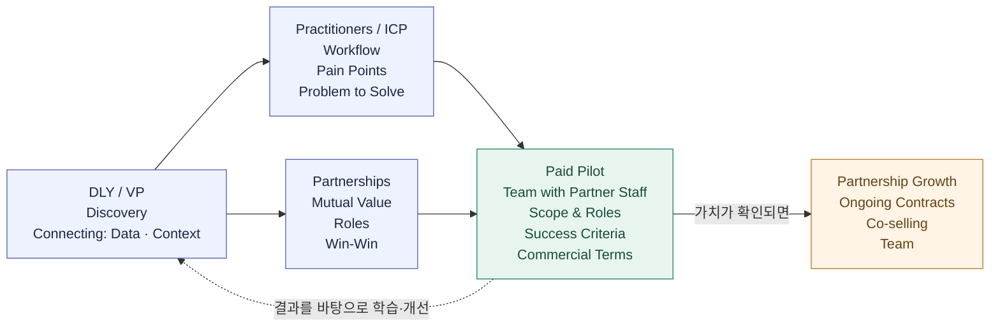

# 왜 연결하는 방식으로 사업을 만드는가

> 2026-10-26 · 업데이트 2026-10-29

## 내 생각

기술과 기능이 빠르게 대체되는 시대에, 현장과 고객을 이해하는 데서 사업의 가치를 만들어가려 합니다.

내 사업의 지분과 주도권을 지키면서, 파트너와 함께 가치를 만들고 성장해가려 합니다.

현장에 들어가 고객의 이야기를 듣고 신뢰를 쌓는 일을 계속해가려 합니다. 그 위에서 사례를 모으며 다음 세 방향을 구체화해가려 합니다.

1. **파트너십**: 고객이 이미 사용하는 툴을 제공하는 기업과 협력 관계를 만들고, 기존 생태계 안에서 고객 도입과 영어권 시장 확장을 함께 추진하기.
2. **제품 방향**: 기존 툴에서 쓰이는 데이터와 맥락을 연결해 고객의 더 나은 의사결정을 돕기.
3. **팀**: 나와 에이전트, 파트너사 내부 인원이 소규모 프로젝트 팀으로 함께 일하기. 파일럿부터 각자의 역할을 정하고, 함께 일하며 필요한 역량을 갖춰가기.

### 파트너와 어떻게 사업을 만들어갈 것인가

나와 에이전트가 실무자와 소통하며 문제와 사용 중인 도구를 알아갑니다. 그 문제를 함께 해결할 파트너를 찾고, 파트너사 내부 인원과 소규모 팀으로 유료 파일럿을 진행하려 합니다. 결과를 바탕으로 데이터와 맥락을 연결하는 역량을 키우고, 다음 계약과 협력으로 이어가려 합니다.

**내가 지향하는 사업 흐름**

> **Seokhee + Agents** 
> → **Practitioner Discovery** 
> → **Partner Fit** 
> → **Paid Pilot · Team with Partner Staff** 
> → **Repeat Business & Growth** 
> ⇢ **Fundraising / Exit**

나와 에이전트에서 출발해 실무자의 문제를 알아가고, 함께 해결할 파트너와 역할을 맞춥니다. 파트너사 내부 인원과 소규모 팀으로 유료 파일럿을 수행하고, 확인한 가치를 반복 계약과 성장으로 이어가려 합니다. 마지막의 ⇢는 성과와 상호 의사·조건이 맞을 때 검토하는 선택지입니다. 함께 일한 파트너의 투자나 인수도 그 가능성에 포함합니다.

**DLY / VP — Discovery · Connecting**

사람들을 만나 이야기를 듣고, 실무자의 문제와 파트너와 함께할 가능성을 알아갑니다. 필요한 데이터와 맥락을 연결해 실무자가 활용할 수 있게 돕고 싶습니다.

**Practitioners / ICP — 실무자와 해결할 문제 찾기**

실무자와 이야기하며 어떻게 일하고, 무엇이 어려운지 알아갑니다. 그중 내가 함께 해결할 문제를 찾습니다.

**Partnerships — 함께할 이유와 역할 찾기**

파트너와 서로 무엇을 보태고 얻을 수 있는지 알아갑니다. 각자의 강점을 바탕으로 함께 일할 수 있는 구조를 그립니다. 혼자 현장에서 계약까지 이어가기 쉽지 않다고 느끼기에, 파트너와 함께 들어갈 수 있는 환경을 만드는 것이 중요하다고 생각합니다.

**Paid Pilot — 파트너사 내부 인원과 유료로 문제 해결하기**

나와 에이전트, 파트너사 내부 인원이 소규모 팀으로 현장에 들어가 해결할 문제와 각자의 역할을 정하고, 유료로 진행합니다. 기간·비용·비용을 부담할 주체와 수익 배분을 합의하고, 실제 업무에서 도움이 되는지 확인합니다. 비용을 부담하는 쪽은 현장 조직과 파트너 기업 모두 열어두고 있습니다.

**Partnership Growth — 성과를 다음 계약과 협력으로 이어가기**

함께 만든 성과를 바탕으로 지속 계약과 공동판매를 넓혀갑니다. 필요한 역량과 팀을 갖추고, 성과와 상호 의사·조건이 맞으면 투자 유치나 엑싯도 검토합니다.

현재 지향하는 사업 흐름입니다. 이 그림을 두고 내가 보태려는 가치를 하나씩 실제로 확인해가려 합니다. 결과를 바탕으로 방향을 고치고, 도움이 된 경험을 역량과 사업의 강점으로 쌓아가려 합니다.

### 생각하는 수익모델

파트너 생태계에 연결해 도입할 수 있는 수익모델을 만들어가려 합니다. 초기에는 파트너와 수행할 유료 파일럿이나 서비스의 범위를 합의하고, 지속적인 사용에 맞는 요금 구조를 구체화하려 합니다.

- **초기 셋업**: 초기 도입 부담을 낮춘 비용.
- **구독**: 지속적인 서비스 이용에 대한 요금.
- **추가 사용료**: API 호출 등 사용량에 따른 요금.

## benchmarking

### product

- **[Glean — 흩어진 근거를 업무 맥락으로 연결하기](glean-product-tech-benchmark-ko.md)**: 콘텐츠·사람·활동의 그래프, 식별자·출처·권한·최신성을 연결하는 구조와 RTP 참고점을 정리합니다.
- **[Wiz — 근거를 공동 검토와 조치로 이어가기](wiz-product-tech-benchmark-ko.md)**: 실제 고객 사례에서 발견·공동 검토·수정·확인이 이어지는 흐름과 RTP 참고점을 정리합니다.

두 회사 모두 정보와 사람·업무를 연결합니다. 먼저 Wiz의 전체 흐름을 깊게 보고 Glean의 근거 연결 기술도 함께 벤치마킹하려 합니다. 하나를 깊게 보는 선택지를 유지하면서, 흩어진 근거 연결과 여러 전문가의 공동 판단이라는 두 방향을 배웁니다. 구체적인 제품 효용과 구현 방식은 별도로 확인해갈 가설입니다.

### partnership/team

**내가 지향하는 플레이**: [Manu Ginóbili](manu-ginobili-role-reference-ko.md) 같은 플레이를 선호하고, 내 현장 이해와 제품을 더해 파트너 기업이 더 잘하도록 돕고 함께 성장해가려 합니다.

**지금 중점적으로 볼 질문:** 아직 제품과 관계가 충분하지 않을 때, 무엇을 제공해 첫 공동 작업을 시작했는가? 당시 가진 기술·경험·인맥과 부족했던 것을 구분하고, 첫 제안과 작은 작업의 범위, 상대가 함께한 이유, 다음 작업으로 이어진 근거를 살펴보려 합니다. 사업 방식과 함께, 그 과정에서 어떤 제품 방향이 잡혔는지도 보려 합니다.

- **[Zapier × 첫 고객: 기존 관계 없이 문제를 찾아 첫 유료 작업으로 연결하기](zapier-first-customer-case-study-ko.md)**

[중심에서 삶과 실행으로](center-life-means-experiments-ko.md)

## 참고 문헌

조여준(Ethan Cho)의 [「공룡의 멸종 사이클이 빨라지고 있다」](https://lnkd.in/p/gHwyqDvq)는 AI 시장에서 모델 성능과 UX의 차별화가 빠르게 따라잡힐 수 있으며, 고객에게 도달하는 경로와 고객 맥락을 이해하는 기반이 중요하다고 이야기합니다.
