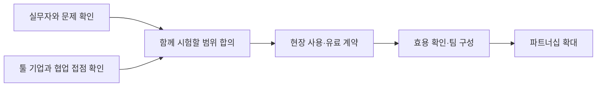
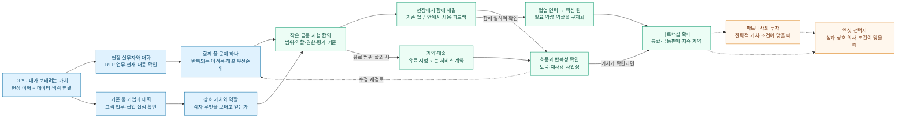

# 왜 연결하는 방식으로 사업을 만드는가

> 2026-10-26 · 업데이트 2026-10-28

## 내 생각

기술과 기능이 빠르게 대체되는 시대에, 현장과 고객을 이해하는 데서 사업의 가치를 만들어가려 합니다.

내 사업의 지분과 주도권을 지키면서, 파트너와 함께 가치를 만들고 성장해가려 합니다.

현장에 들어가 고객의 이야기를 듣고 신뢰를 쌓는 일을 계속해가려 합니다. 그 위에서 사례를 모으며 다음 세 방향을 구체화해가려 합니다.

1. **파트너십**: 고객이 이미 사용하는 툴을 제공하는 기업과 협력 관계를 만들고, 기존 생태계 안에서 고객 도입과 영어권 시장 확장을 함께 추진하기.
2. **제품 방향**: 기존 툴에서 쓰이는 데이터와 맥락을 연결해 고객의 더 나은 의사결정을 돕기.
3. **팀**: 파트너사의 기술·판매 인력과 함께 일하는 방식을 만들기. 협력하면서 직접 갖춰야 할 역량을 파악하고, 그에 맞춰 핵심 팀을 꾸려가기.

### 파트너와 어떻게 사업을 만들어갈 것인가

현장 실무자와 RTP 업무의 문제를 알아가는 동시에, 기존 툴을 제공하는 기업과 협업 접점을 찾으려 합니다. 함께 풀 문제와 서로 보탤 가치가 구체화되면 작은 공동 시험의 범위와 역할을 정하고, 현장에서의 사용과 계약으로 이어가려 합니다.

함께 일하며 필요한 역량과 팀을 구체화하고, 확인된 가치를 바탕으로 협력을 넓혀가고 싶습니다.

전체 사업 흐름 보기 — 투자·엑싯 선택지 포함

현재 지향하는 사업 흐름입니다. 투자와 엑싯은 성과와 상호 의사, 조건이 맞을 때 검토할 선택지입니다. 유료 범위를 합의할 수 있으면 첫 시험부터 계약할 수 있습니다.

### 생각하는 수익모델

파트너 생태계에 연결해 도입할 수 있는 수익모델을 만들어가려 합니다. 초기에는 공동 시험이나 서비스의 유료 범위를 합의하고, 지속적인 사용에 맞는 요금 구조를 구체화하려 합니다.

- **초기 셋업**: 초기 도입 부담을 낮춘 비용.
- **구독**: 지속적인 서비스 이용에 대한 요금.
- **추가 사용료**: API 호출 등 사용량에 따른 요금.

## 참고한 것들

### 제품 방향에서 참고하는 것

- **Glean**: 흩어진 정보와 맥락을 연결해 필요한 내용을 이해하고 활용하도록 돕는 방식.
- **Wiz**: 서로 다른 전문가들이 같은 상황을 한눈에 이해할 수 있도록 정보를 연결하고 시각화하는 방식.

### 파트너십과 팀에서 참고하는 플레이와 사례

**내가 지향하는 플레이**: [지노빌리](manu-ginobili-role-reference-ko.md) 같은 플레이를 선호하고, 내 현장 이해와 제품을 더해 파트너 기업이 더 잘하도록 돕고 함께 성장해가려 합니다.

- **[AWS Global Startup Program](https://aws.amazon.com/partners/programs/global-startup/)**: AWS 기술 전문가·Partner Solutions Architect의 제품 설계와 고객 적용 지원, Account Manager와의 공동판매를 제공하는 프로그램. 초청·참여 요건이 있습니다.
- **[Pixellot–Prozone (2015)](https://www.pixellot.tv/press-releases/prozone-invests-1m-in-israeli-technology-company-pixellot/)**: Prozone이 Pixellot에 미화 100만 달러를 투자하고, 양사의 기술과 Prozone의 기존 프로스포츠 고객 기반을 연결하는 협력을 발표한 사례.

[중심에서 삶과 실행으로](center-life-means-experiments-ko.md)

## 참고 문헌

조여준(Ethan Cho)의 [「공룡의 멸종 사이클이 빨라지고 있다」](https://lnkd.in/p/gHwyqDvq)는 AI 시장에서 모델 성능과 UX의 차별화가 빠르게 따라잡힐 수 있으며, 고객에게 도달하는 경로와 고객 맥락을 이해하는 기반이 중요하다고 이야기합니다.
