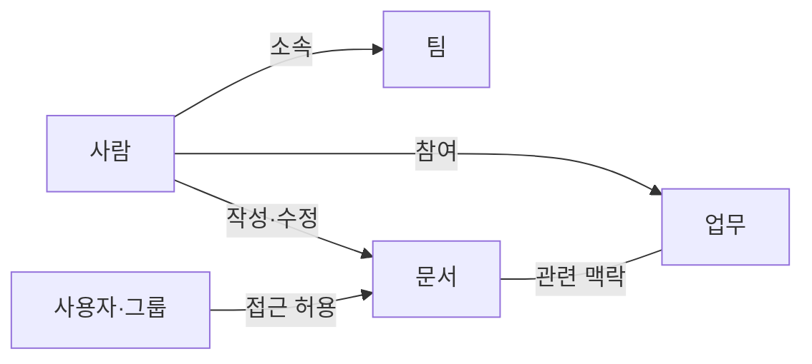
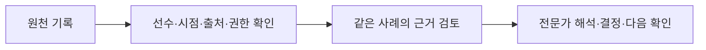

# Glean — 흩어진 근거를 업무 맥락으로 연결하는 기술 벤치마킹

> 2026-10-29 · 공식 문서 확인 · RTP 적용은 설계 가설

[사업 방향으로 돌아가기](connected-ecosystem-business-rationale-ko.md#product) · [Wiz 벤치마킹](wiz-product-tech-benchmark-ko.md)

## 내가 배우려는 것

RTP 판단에 쓰는 검사 결과·선수 보고·현장 기록이 여러 도구에 나뉘어 있을 때, 같은 선수의 관련 시점과 출처를 확인하면서 검토할 수 있도록 돕고 싶다. Glean에서 이 연결의 기반을 배운다. Wiz를 먼저 깊게 보면서 Glean도 계속 벤치마킹한다.

두 회사 모두 정보와 사람·업무 관계를 다룬다. Glean은 근거 연결, Wiz는 공동 검토라는 구분은 나의 학습 초점이다.

## 핵심 — 콘텐츠·사람·활동의 관계

Glean Knowledge Graph는 문서·메시지·티켓 같은 콘텐츠, 사용자·팀·역할, 수정·참여 등의 활동을 연결한다. 이 관계를 검색의 관련성과 개인화에 사용하고, 가까운 협업자와 프로젝트 참여 맥락도 제공한다. [Knowledge Graph 공식 문서](https://docs.glean.com/security/knowledge-graph)

다음은 공식 설명을 단순화한 관계 예시이며 내부 DB 스키마가 아니다.

공식 문서에서는 Knowledge Graph와 Enterprise Graph라는 표현이 함께 쓰인다. 별도 제품 두 개나 특정 시점의 완전한 개명으로 단정하지 않는다. [Enterprise Context 페이지](https://www.glean.com/platform/enterprise-context)의 그래프 직접 탐색은 2026-10-29 조회 시 coming soon 표기다. 관계 모델과 실제 사용자가 보는 화면은 구분해서 읽는다.

## 데이터가 답변과 업무로 이어지는 과정

| 단계 | 공식 문서에서 설명하는 역할 |
|---|---|
| 연결 | 커넥터가 콘텐츠·메타데이터·권한과 지원되는 활동 신호를 가져옴 |
| 정리 | 앱 간 인물 식별자를 맞추고 검색 인덱스·관계 맥락 구성 |
| 검색 | 현재 사용자의 접근 권한과 관련성을 고려해 근거 검색 |
| 최신성 | 자료 특성에 따라 인덱스·실시간 조회·혼합 방식 사용 |
| 답변 | 찾은 근거를 사용해 답변하고 원문 확인용 출처 제공 |
| 실행 | 설정·권한이 허용하는 도구로 티켓 변경 등 작업 수행 |

[커넥터와 Enterprise Graph](https://docs.glean.com/connectors/connectors-power-glean). 앱이 노출하는 데이터와 커넥터·동기화·설정에 따라 범위가 달라진다. 모든 답변에 동일한 출처 표시가 있거나 모든 작업을 자동 수행한다는 보장은 아니다.

제품 설명의 일반적인 활용 예는 업무 티켓·관련 문서·대화에서 맥락을 찾아 질문에 답하는 것이다. 이는 공개 기능 설명이며 이 노트에서 특정 고객의 전체 처리 결과를 독립 검증한 사례는 아니다.

## RTP 판단 지원에서 내가 벤치마킹할 부분

| 배울 원리 | 우리에게 필요한 설계 질문 | 확인할 실패 |
|---|---|---|
| 동일 대상 식별 | 서로 다른 도구의 기록이 같은 선수임을 어떻게 확인하나? | 동명이인·잘못된 ID 연결 |
| 관련 시점 선택 | 검사 시각과 설문·활동 기간은 어떤 관계인가? | 날짜만 같아 무관한 기록을 묶음 |
| 원출처 보존 | 수치·관찰·수정 이력으로 돌아갈 수 있나? | 요약만 남아 근거 확인 불가 |
| 권한 존중 | 각 역할이 볼 수 있는 범위가 출력에 반영되나? | 검색·요약을 통한 정보 노출 |
| 최신성 표시 | 기록 발생·입력·수정·동기화 시점을 구분하나? | 오래된 제한이나 수정 전 값 사용 |
| 불확실성 표시 | 기록이 없거나 연결이 모호하면 어떻게 보이나? | 누락을 정상·문제없음으로 처리 |

이 표는 Glean 기능을 RTP 제품으로 번역해보는 설계 유추다. Glean이 스포츠 데이터를 이미 정확히 연결한다는 의미는 아니다.

예를 들어 실무자가 특정 검사 결과를 선택하면, 제품은 관련 기간의 선수 보고와 활동 기록을 출처·시점과 함께 제시할 수 있다. 담당자는 연결이 맞는지 확인하고 자신의 해석을 더한다. 같은 날짜의 두 변화가 함께 보인다는 이유만으로 인과관계를 만들어서는 안 된다.

## Wiz와 함께 볼 지점

Glean에서 배운 식별·권한·출처·최신성은 [Wiz 노트](wiz-product-tech-benchmark-ko.md)의 공동 검토 흐름을 뒷받침하는 기반이 될 수 있다.

이는 우리 제품의 검토용 흐름이다. 두 회사를 조합한 시스템이 이미 구현됐거나 효과가 입증됐다는 설명은 아니다.

## 먼저 확인할 것과 보류할 것

- 우선: 한 사례에서 필요한 기록을 정확하게 연결하고, 원출처·시점·권한·미확인을 보존할 수 있는지.
- 비교: 현재 사용하는 도구나 수동 표로도 충분한지, 정정·재확인까지 포함한 총 부담이 줄어드는지.
- 아직 선택하지 않음: 전사 검색, 모든 도구의 커넥터, 그래프 DB, 자율 에이전트, 특정 화면.
- 공개 자료의 한계: 내부 저장 스키마·일치 판단 알고리즘·조직별 성능·우리 데이터 접근 가능성은 미확인.

## 읽는 순서

1. [Knowledge Graph](https://docs.glean.com/security/knowledge-graph): 무엇을 관계로 연결하는가.
2. [커넥터 설명](https://docs.glean.com/connectors/connectors-power-glean): 수집·식별·권한·최신성·답변까지 어떻게 이어지는가.
3. [Enterprise Context](https://www.glean.com/platform/enterprise-context): 현재 제품 표현과 화면 제공 상태.
