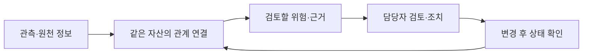
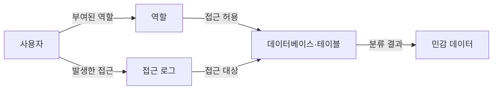

# Wiz — 근거를 공동 검토와 조치로 이어가는 기술 벤치마킹

> 2026-10-29 · 공개 자료 기반 · 제품 설명 / 고객 보고 / RTP 설계 유추를 구분

[사업 방향으로 돌아가기](connected-ecosystem-business-rationale-ko.md#product) · [Glean 벤치마킹](glean-product-tech-benchmark-ko.md)

## 왜 먼저 깊게 보는가

내가 지향하는 RTP 판단 지원은 관련 근거를 연결하고, 여러 전문가가 서로의 정보를 자기 판단에 사용하며, 다음 행동과 이후 반응을 이어서 검토하는 제품이다. Wiz에서 이 전체 흐름을 먼저 깊게 보고, Glean에서 정보 연결의 기반을 함께 배운다. 두 회사 모두 정보와 사람·업무를 연결하며, 이 구분은 내가 배우려는 초점이다.

## 핵심 구조

Wiz Security Graph는 코드·클라우드 자산·계정과 권한·네트워크·데이터·위험의 관계를 연결한다. 관계를 통해 영향과 우선순위를 이해하고 담당자가 조치하도록 돕는다. [공식 Security Graph](https://www.wiz.io/lp/wiz-security-graph)

다음은 학습용 흐름이며 내부 구현이나 모든 고객의 운영 절차를 뜻하지 않는다.

## 실제 사례 — Colgate-Palmolive의 Snowflake 점검

2024년 Snowflake 고객 계정을 겨냥한 공격 캠페인 이후 이 회사가 자사 환경을 점검한 사례다. 해당 회사가 침해됐다는 사례로 읽지 않는다.

| 단계 | 고객 사례에서 확인된 내용 |
|---|---|
| 계기 | 외부 공격 소식을 계기로 자사 영향 확인 |
| 기존 상태 | Okta MFA를 이미 사용하고 있었음 |
| 연결·검토 | 기존 Wiz Snowflake Connector로 보안·개발팀이 공동 점검 |
| 문제 발견 | 이전에 찾지 못한 과도한 권한·설정 문제 식별 |
| 처리 | 문제의 우선순위를 정해 수정했다고 보고 |
| 확인 | 제3자 보안 상태 점검에서 좋은 결과를 얻었다고 보고 |

[Colgate-Palmolive 고객 사례](https://www.wiz.io/customers/colgate-palmolive), 특히 “Meeting the growing challenge…” 절. 공급자가 발행한 고객 증언이다. 개별 Issue·자원명·실제 그래프·수정 명령·외부 점검 보고서는 공개되지 않았다. 따라서 하나의 티켓을 처음부터 끝까지 재현한 기록은 아니며, 발견부터 확인까지 공개된 업무 경로를 따라간다. 페이지 발행일은 미확인, 사건 배경은 2024년이다.

## 이 과정을 가능하게 하는 연결 — 별도의 제품 설명

Snowflake Connector의 2024-09-25 설명에는 다음 네 범주가 나온다.

| 입력 | 연결해서 이해하는 것 |
|---|---|
| 데이터베이스·테이블의 민감 정보 분류 | 보호해야 할 데이터 |
| 사용자·역할·grants·실효 권한 | 누가 무엇에 접근할 수 있는가 |
| 인증·계정 등 설정 | 보안 기준에서 벗어난 조건 |
| 접근 로그 | 실제 접근과 의심스러운 활동 |

[Snowflake Connector 공식 설명](https://www.wiz.io/blog/introducing-wiz-snowflake-connector). 아래는 설명용 관계 예시이며 Colgate의 실제 화면이나 정확한 스키마가 아니다.

기술적으로 볼 지점은 관계의 의미다. 데이터가 존재한다는 사실에 사용자·권한·설정·활동을 붙여 검토할 위험을 설명한다. 공식 제품 글의 “MFA가 없는 사용자” 예시는 Colgate의 발견 사항으로 가져오지 않는다. Colgate는 MFA를 이미 사용했다.

## 담당자와 완료 확인은 어떻게 이어지는가

더 구체적인 상태 전환은 Wiz의 비밀키 노출 **제품 예시**에서 확인할 수 있다. 아래는 위 고객 사건과 별개다.

1. 키가 실제 유효한지 확인한다.
2. 접근 가능한 자원과 영향 범위를 연결한다.
3. 코드 작성자 또는 저장소 소유자 정보로 담당자를 연결한다.
4. IDE·PR·Jira·Slack 등에 조치 안내를 제공한다.
5. 주기적으로 키를 검사해 유효 상태에서 무효 상태로 바뀌었는지 확인한다.

[Secrets Found. Owners Identified. Issues Fixed.](https://www.wiz.io/blog/secrets-found-owners-identified-issues-resolved), 2025-08-26. 이는 공급자의 기능 설명이며 모든 Issue가 이 방식으로 자동 해결된다는 뜻은 아니다. 키 무효화는 해당 확인 항목의 결과이며 전체 환경의 무위험을 의미하지 않는다.

## RTP 판단 지원에서 내가 벤치마킹할 부분

아래는 제품 설계 유추다. 실제 선수 사례·임상 권고·검증된 제품 효용을 뜻하지 않는다.

| 배울 구조 | RTP에 적용해볼 질문 | 유용한 출력 후보 |
|---|---|---|
| 검토할 문제의 단위 | 이 선수의 이번 참여 검토에서 무엇을 결정·확인하려 하나? | 결정 장면과 남은 질문 |
| 관계에 근거 붙이기 | 검사·선수 보고·활동 기록이 같은 선수·어떤 시점에 해당하나? | 원출처·시점·연결 이유 |
| 여러 역할의 검토 | 각 전문가가 무엇을 관찰했고 어떻게 해석하나? | 관찰·해석·이견·미확인의 구분 |
| 담당과 권한 | 누가 추가 확인하고 누가 해당 결정을 맡나? | 확인 담당·판단 담당·현재 허용 범위 |
| 후속 결과 | 정한 활동 후 무엇이 관측됐고 다시 검토할 이유가 있나? | 실행 기록·이후 반응·재평가 상태 |

가령 제품이 “이번 훈련 참여 범위를 검토한다”는 사례를 만든다면, 담당자가 선택한 검사와 관련 기간의 선수 보고·활동 기록을 보여주고, 각자의 해석과 추가 확인 사항을 붙일 수 있다. 실제 결정과 후속 관측이 같은 사례에 이어져야 한다. 화면 모양은 다이어그램·타임라인·표 가운데 어떤 것이 실무자에게 도움이 되는지 확인한다.

내가 특히 가져오고 싶은 것은 **검토할 질문 → 연결된 근거 → 역할별 해석 → 다음 행동 → 이후 확인**의 흐름이다. 기존 회의와 도구에서 이 흐름이 이미 잘 이어진다면 추가 제품의 가치는 별도로 입증해야 한다.

## 그대로 옮기지 않을 부분

- 보안의 위험 등급·공격 경로 규칙을 선수의 복귀 승인이나 임상 위험 점수로 치환하지 않는다.
- 권한 관계의 존재와 선수 상태 변화의 인과관계는 다르다. 함께 나타난 수치·증상으로 원인을 확정하지 않는다.
- 공동 검토에서도 선수 의사, 의료 결정 권한, 역할별 접근 범위와 의견 차이를 남긴다.
- 티켓 완료, 자료 입력 완료, 선수의 이후 반응 확인은 각각 다른 상태다.
- Wiz의 그래프 DB·AI·자동 조치 방식을 필수 구현으로 정하지 않는다.

## 다음에 검토할 최소 단위

합성 사례 한 건으로 **질문·근거·해석·담당·후속 확인**이 이어지는 보기를 만들어 기존 수동 표와 비교하는 것이 검토 후보다. 의료 기준을 자동 생성하거나 실제 복귀를 판정하는 시험은 아니다.

실제 현장에서는 자료 접근과 동의가 확보된 범위에서 준비·재확인 부담, 잘못 연결된 기록, 누락된 확인, 이견의 보존을 확인할 수 있다. 지금은 벤치마킹과 가설 정리 단계이며 개발·고객 적용을 완료한 상태가 아니다.

## 읽는 순서

1. [고객 사례](https://www.wiz.io/customers/colgate-palmolive): 실제 누가 함께 무엇을 처리했는지.
2. [Snowflake Connector](https://www.wiz.io/blog/introducing-wiz-snowflake-connector): 그 판단을 뒷받침하는 정보 관계.
3. [비밀키 조치 흐름](https://www.wiz.io/blog/secrets-found-owners-identified-issues-resolved): 담당자·업무 전달·상태 확인의 구체적 제품 예시.
4. [Glean 노트](glean-product-tech-benchmark-ko.md): 식별자·출처·권한·최신성 연결을 보완해서 보기.
